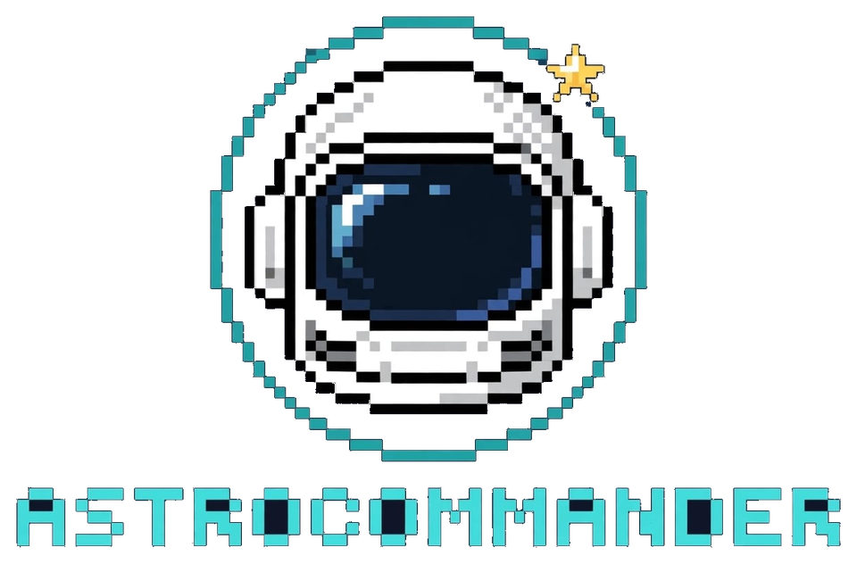

<p align="center">
  
</p>

# Astro Commander

### NASA Space Apps Challenge · Cairo 2026

| | |
|---|---|
| **Event** | NASA International Space Apps Challenge 2026, Cairo local event (13–14 November 2026) |
| **Challenge** | **Build a Junior Astronaut Mission Trainer** |
| **Team** | VOYAGER-X |
| **Project** | Astro Commander, a pixel-art outpost survival game that runs in any browser |
| **Play style** | Single player, keyboard or touch, no account and no download |
| **Languages** | Arabic (Egyptian dialect) and English |
| **NASA data** | Space Weather Database of Notifications, Knowledge, Information (DONKI): solar flares, coronal mass ejections and solar energetic particle events |

---

## Table of contents

1. [The challenge](#1-the-challenge)
2. [The problem we found](#2-the-problem-we-found)
3. [Our solution](#3-our-solution)
4. [How a game session works](#4-how-a-game-session-works)
5. [Trade-offs: no choice is free](#5-trade-offs-no-choice-is-free)
6. [The Storm Shelter base](#6-the-storm-shelter-base)
7. [Mission Control tutorial (ages 12–17)](#7-mission-control-tutorial-ages-1217)
8. [Controls](#8-controls)
9. [Design and accessibility](#9-design-and-accessibility)
10. [Technology and architecture](#10-technology-and-architecture)
11. [Run it locally](#11-run-it-locally)
12. [Install it as an app](#12-install-it-as-an-app)
13. [Project structure](#13-project-structure)
14. [NASA API usage](#14-nasa-api-usage)
15. [Limitations and roadmap](#15-limitations-and-roadmap)
16. [Credits and licenses](#16-credits-and-licenses)

---

## 1. The challenge

NASA Space Apps 2026 asks teams to **design and build an interactive game or app that lets students run a lunar or Martian outpost**. The player has to balance life support, radiation shielding, power and food, so they feel the decisions that make a mission fail or succeed. The challenge asks for three things in particular:

- **Real trade-offs.** A choice that saves power today may cost oxygen tomorrow. There should be no free "safe" option.
- **Real data.** Use NASA open data (for example DONKI) instead of invented numbers, and attribute it inside the tool.
- **Replayability and clarity.** A young player should understand one true constraint of deep-space survival after playing.

Official page: <https://www.spaceappschallenge.org/2026/challenges/junior-astronaut-mission-trainer/>

## 2. The problem we found

Space education for young people tends to fail in one of two ways. It stays at the level of posters and facts, so students never see *why* a mission planner chooses one option over another. Or it becomes pure entertainment and drops accuracy. We also noticed that most mission-trainer ideas are aimed at small children, while teenagers (12–17) are ready for real engineering reasoning but quickly leave anything that feels childish.

## 3. Our solution

**Astro Commander** puts the player on the surface of the Moon or Mars as a mission commander. They explore a pixel-art landscape, run science labs, collect samples, drive a rover and keep four survival resources above zero for a 10-day mission. Solar storms in the game are linked to **real space-weather records from NASA DONKI**, so the danger on screen comes from real solar activity.

What makes it a trainer rather than only a game:

- **Four visible resources** (energy, oxygen, water, protection) that every decision spends or restores.
- **Real NASA events** decide what threatens the outpost each day, with source, date, strength and instrument shown on screen.
- **A storm shelter base** that gives the player a safe choice which still has a cost.
- **A Mission Control tutorial** that teaches by doing, quizzes the player and explains the science behind each action.
- **Replayability:** different planets, 8 astronaut characters, 7 rockets, random storms and a different event order after every failed mission.

## 4. How a game session works

1. **Title screen.** Continue a saved game or start a new one.
2. **Setup.** Pick an astronaut (8 historical and modern suits), name them, choose the Moon or Mars, then choose a rocket (7 real and historical launchers).
3. **Launch and landing.** A short flight cut-scene ends with the lander touching down. The **Storm Shelter is built next to the lander** right after landing.
4. **Exploration.** Walk, jump (jump height depends on the real gravity of the body), scan for samples, send the probe, and ride the rover.
5. **Science labs.** Up to six labs per world (pressure, temperature, soil, atmosphere, gravity, radiation). Each lab has several short mini-games and quizzes that award points.
6. **Special mission.** Each world has its own objective (for example deploying laser reflectors on the Moon or seismometers on Mars).
7. **Mission · NASA panel.** A 10-day survival layer driven by DONKI data (see [section 14](#14-nasa-api-usage)).
8. **Storms.** Random events (solar, dust, wind, quake, volcanic eruption depending on the world) give a warning of about 11–16 seconds. The player decides: **face the storm with a challenge or hide in the shelter.**
9. **Finish.** Complete all labs, the special mission and 5 samples, return to base and plant the flag. Rank goes from Trainee to Legend.

Progress is saved automatically in the browser (`localStorage`). **Continue Game** resumes it and **New Game** asks before deleting it.

## 5. Trade-offs: no choice is free

| Decision | What it gives | What it costs |
|---|---|---|
| Use protection (Mission panel) | +12 protection | −8 energy |
| Make oxygen | +16 oxygen | −14 energy, −4 water |
| Radio check | Keeps contact with Earth | −5 energy, −6 protection |
| Collect a rock or soil sample | Science progress | −10 energy, −3 water |
| Analyse rock composition | Science progress | −12 energy |
| Hide in the storm shelter | No suit damage, no challenge | −6 energy, −2 % oxygen, fewer points, you cannot work while waiting |
| Face a storm outside | More points (+30) and an achievement | Risk of −20 points and a stun if you fail |
| Use the probe | Saves walking and oxygen | 25 s recharge |
| Scan | Reveals samples for 8 s | 10 s recharge |

Oxygen also drains continuously in real time at a resting-adult rate (about 0.25 L per minute in the model), so waiting is never free. If energy, oxygen, water or protection reaches zero the mission fails and can be replayed with a different event sequence.

## 6. The Storm Shelter base

Astro Commander includes a **buildable storm shelter**: a dome habitat partly buried in soil, with an airlock door, a solar panel, an antenna with a beacon and a radiation sign. It is inspired by real lunar-habitat concepts that pile regolith (surface soil) on top of living space to stop radiation.

How it works in play:

1. After the lander touches down, a construction site appears next to it and the shelter is **built in front of the player** (a short animation with dust and sound).
2. When a storm warning appears, the HUD banner, the compass and the Control Center all point to the shelter. The player has about 11–16 seconds to reach it.
3. Standing at the door shows an **Enter shelter** button (or press `E` / `Enter`). Inside, the player is hidden and a status panel shows the storm progress bar, the four resource bars and a real-science fact about that type of storm.
4. If the storm hits while the player is inside, the usual challenge is skipped. When it ends the player pays the cost (see the table above), gets a smaller reward (+12 points) and earns the **Shelter survivor** achievement the first time.
5. If the storm misses, nothing is lost. The player can leave at any time except while the storm is hitting.
6. The shelter also shows on the mini-map as a light-blue block, and it works on both the Moon and Mars. Hiding from a storm that never arrives still burns oxygen in real time, which keeps "always hide" from being the best strategy.

The in-shelter facts are short and checked against NASA material: regolith shielding, Martian dust storms dimming solar power and the very thin Martian air (under 1 % of Earth's pressure), Io's volcanism, and the more than 1,300 marsquakes recorded by InSight.

## 7. Mission Control tutorial (ages 12–17)

The first trip starts with a **Mission Control briefing**. It was rewritten for teenagers: short and direct sentences, a real-world reason behind every step, and no childish tone. Everything is available in Arabic and English, with separate wording for touch controls.

**It reacts to the player.** Every step waits for the real action and then answers it:

- **Choose your briefing:** *Full training* (about 4 minutes), *Quick briefing* (essentials only) or *Skip*.
- **Your own astronaut speaks to you.** The player's chosen character and name appear on every card, and Mission Control addresses them as "Commander".
- **Live feedback.** Moving, jumping, scanning, collecting, probing, entering a lab, riding the rover and using the control center are all detected from real gameplay. A varied praise line appears when each step is done.
- **"Why does it matter?" button.** Expands a short real-science reason (for example, Apollo crews brought back about 382 kg of Moon rock).
- **Emergency drill.** A simulated solar storm alert starts a 30-second timer. The player must run to the shelter (an arrow and the compass guide them), get inside, wait for the drill to finish and walk out. Two failed tries move on gently.
- **Two quick quizzes.** One on what to do when a storm warning arrives far from base, one on where the Sun events in the Mission panel come from. A wrong answer gives a hint and lets the player try again, a right answer explains why.
- **Reward.** Finishing the tutorial for the first time gives +25 points and the **Training graduate** achievement. Quiz answers give small bonus points once.
- **Replay any time** with the **🎓 Tutorial** button in the game or from Settings.

**Readability.** The tutorial panels are nearly opaque (about 98 % solid), use large white text on a dark gradient and a frosted-glass **background blur** behind the box. Full-screen steps dim and blur the whole game so the text is easy to read, while small hint bubbles blur only what is directly behind them so the player can still see the world.

## 8. Controls

| Action | Keyboard | Touch |
|---|---|---|
| Move | Arrow keys or `W A S D` | Virtual joystick |
| Jump | `Space` | Jump button |
| Scan for samples | Scan button | Scan button |
| Send probe | Probe button | Probe button |
| Enter lab, shelter, rover or plant flag | `E` or `Enter` | Action button |
| Open NASA mission panel | Mission · NASA button | Mission · NASA button |
| Language | English / عربي button | English / عربي button |

## 9. Design and accessibility

- **No barrier to entry:** a browser game with no account, no install and an optional offline install as a PWA.
- **Plain language first.** Technical words (radiation, regolith, CME, SEP) are explained in context, in the tutorial, in lab hints and in the shelter facts.
- **Honest data labels.** The game always shows whether NASA data is *live* or *stored*.
- **Responsive.** Tested on desktop and in a landscape phone layout, with safe-area handling for notched phones and large touch targets.
- **Reduced motion** is respected, and focus outlines are visible on keyboard navigation.
- **Right-to-left aware.** Arabic uses RTL layout and English switches to LTR on the fly.

## 10. Technology and architecture

| Layer | Choice |
|---|---|
| Engine | [Phaser 3.80.1](https://phaser.io), bundled locally in `assets/phaser.min.js` |
| Language | Plain JavaScript, HTML and CSS in a single `index.html` (no build step) |
| Art | Pixel art drawn in code on canvas (terrain, characters, rockets, rover, shelter), plus the Astro Commander logo |
| Audio | Procedural Web Audio (music, ambience and effects) with no audio files |
| Storage | `localStorage` keys: `ac_gameSave` (save game), `ac_prog` (best scores), `ac_lang` (language), `ac_tut` (tutorial state) |
| Offline | Service worker (`sw.js`) caches the app shell, engine, manifest and icons |
| NASA data | DONKI REST API through `fetch`, with a stored fallback |

Main modules inside `index.html`:

- **Game scene (`Explore`):** terrain generation, camps and labs, samples, rover, probe, the event system (`forecast` → `resolveEv` → minigame) and the mini-map.
- **Storm Shelter module:** `shelterCv` (pixel art), `buildShelter`, `deployShelter`, `enterShelter`, `leaveShelter`, `shelterHit`, `shelterEnd`. It extends the scene without changing the original storm minigames.
- **`ACNASA` module:** the 10-day survival layer, resource simulation and DONKI loader.
- **`TUT` module:** the Mission Control tutorial (steps, quizzes, drill, praise, hint overlays).

## 11. Run it locally

A static web server is needed because service workers and PWA install do not work from `file://`.

```sh
cd Hackathon-Project-VOYAGER-X--main
python3 -m http.server 8000
```

Open <http://localhost:8000>. For hosting, publish the folder contents to the site root over HTTPS (GitHub Pages, Netlify or any static host). The live NASA call needs internet access; offline, the game uses its stored data automatically.

## 12. Install it as an app

Use the browser's **Install app** or **Add to Home Screen**. The Astro Commander helmet logo is used for the favicon, the Android/PWA icons and the Apple home-screen icon. After the first visit the game reopens offline.

## 13. Project structure

```
index.html                  Game, interface, tutorial, shelter and NASA layer
manifest.webmanifest        PWA name, display mode and icons
sw.js                       Offline caching (cache name: astro-commander-v3)
assets/
  astro-commander-logo.png  Title-screen logo (transparent background)
  logo-original.jpg         Original logo artwork
  icon-192.png, icon-512.png, icon-512-maskable.png,
  apple-touch-icon.png, favicon-32.png
  phaser.min.js             Phaser 3.80.1 engine (bundled)
LICENSE-PHASER.txt          Phaser license notice
README.md                   This file
```

## 14. NASA API usage

### 14.1 What we use and why

The challenge names DONKI as a way to link gameplay to actual solar activity and radiation risk. Astro Commander uses **DONKI** (Space Weather Database of Notifications, Knowledge, Information, run by NASA's Community Coordinated Modeling Center at Goddard) because solar storms are the most important radiation risk for the Moon and Mars, where there is no thick atmosphere or global magnetic field to protect astronauts.

| DONKI endpoint | Event type | What it means for the player |
|---|---|---|
| `/get/FLR` | **Solar flare** | A sudden burst of light and X-rays. Radio can be disturbed within minutes. |
| `/get/CME` | **Coronal mass ejection** | A cloud of charged gas from the Sun. Faster clouds need more protection. |
| `/get/SEP` | **Solar energetic particle event** | Fast protons and electrons that raise radiation around a spacecraft or outpost. |

### 14.2 How we call it

```js
const API = 'https://ccmc.gsfc.nasa.gov/DONKI-API/get/';
// last 30 days, one request per event type, in parallel
fetch(API + 'FLR?startDate=YYYY-MM-DD&endDate=YYYY-MM-DD', { mode: 'cors' })
fetch(API + 'CME?startDate=YYYY-MM-DD&endDate=YYYY-MM-DD', { mode: 'cors' })
fetch(API + 'SEP?startDate=YYYY-MM-DD&endDate=YYYY-MM-DD', { mode: 'cors' })
```

- **No API key is required** for this endpoint, and it allows cross-origin browser requests, so the game works from a plain static site. (NASA's `api.nasa.gov/DONKI` mirror also exists but needs a key and is rate limited, so we did not rely on it.)
- The game loads the **last 30 days** and keeps up to **10 records of each type**.
- Calls run when a game starts. If any call fails, returns nothing or the player is offline, the game switches to the stored fallback described below.

### 14.3 Fields we read

| DONKI field | Used for |
|---|---|
| `flrID` / `activityID` / `sepID` | Record identity shown in the panel |
| `beginTime` / `startTime` / `eventTime` | Event date |
| `classType` (flare) | Strength (A, B, C, M, X) which sets the event grade |
| `cmeAnalyses[].speed` (km/s, most accurate analysis) | CME speed which sets the grade (above 500 km/s is moderate, above 900 km/s is severe) |
| `cmeAnalyses[].enlilList[].estimatedShockArrivalTime` | Estimated arrival time of the cloud |
| `instruments[].displayName` | The sensor that detected the event, shown on screen |
| `sourceLocation`, `activeRegionNum` | Where on the Sun it started |
| `linkedEvents[]` | Number of linked events, which raises the SEP grade |

### 14.4 How real data changes gameplay

- Each of the 10 mission days is built around **one real DONKI event**. The Mission · NASA panel shows its title, date, strength, sensor, source region and number of linked events.
- When a random event is rolled, there is about a **65 % chance that it becomes a solar storm tied to the current DONKI record**. The warning shown to the player carries the real title and date (`NASA DONKI ALERT · Solar flare M1.5 · 2025-01-04`).
- Surviving or failing a solar storm changes the **protection** resource, and the player's day plan (protection, oxygen, communication, science task) changes what they can afford when the next event arrives.
- The science task offered each day depends on the event type: *flare* gives an observation task, *CME* an exploration task and *SEP* a sample task.
- The in-game **Sources** button opens a panel with the data source, the dataset date, the endpoint and the fallback information.

### 14.5 Honest data labelling and fallback

The challenge says static data must never be passed off as live. The game shows one of two labels everywhere the data is used:

- 🟢 **Live NASA DONKI data**: the request succeeded.
- 🟠 **Stored Data – Not Live**: the request failed or the player is offline.

The fallback is a small embedded set of **real DONKI records from 4 January 2025** (a flare, a coronal mass ejection, a solar energetic particle event and a linked flare event). It is only used when the live call is unavailable, so the game stays playable and honest offline.

### 14.6 Other NASA-related content

Besides the live DONKI feed, the game uses **curated facts** written from public NASA material, not API calls: gravity values of each world, temperature and pressure ranges, soil composition of the Moon and Mars, and mission history in the science labs (Apollo, Artemis, InSight, Luna and Mercury references). These are embedded in `index.html` and are not presented as live.

NASA's Open Science Data Repository (OSDR) and Artemis surface-mission datasets are good next steps (see [section 15](#15-limitations-and-roadmap)); we do not use them yet.

### 14.7 Attribution

Space-weather data: **NASA / Goddard Space Flight Center, Community Coordinated Modeling Center (CCMC), DONKI**. Astro Commander is an independent hackathon project and is not endorsed by NASA. NASA is not responsible for third-party use of its data.

## 15. Limitations and roadmap

- The challenge audience is ages 7–12. Astro Commander is playable by that group, but the tutorial and wording are tuned for teenagers (12–17) and older siblings, which the challenge allows.
- Only DONKI is connected live. Planned: OSDR astronaut-health findings as in-game facts, real Artemis and Mars surface environment data for each site, and food production as a fifth resource.
- Extra worlds (Mercury, Venus, Jupiter's and Saturn's moons and more) exist in the game data, but the setup screen currently offers the Moon and Mars.
- Game narration and lab minigame text are mostly Arabic. The menus, tutorial, Mission panel and shelter are fully bilingual.
- Possible additions: a shelter upgrade system (thicker regolith, a larger battery), a teacher mode with a score summary and a classroom leaderboard.

## 16. Credits and licenses

- **Team VOYAGER-X**, NASA Space Apps Challenge Cairo 2026.
- Game engine: [Phaser](https://phaser.io), MIT license (see `LICENSE-PHASER.txt`).
- Fonts: Cairo and Press Start 2P from Google Fonts.
- Data: NASA DONKI (public NASA open data).
- Logo: Astro Commander pixel-art helmet (`assets/logo-original.jpg`).
